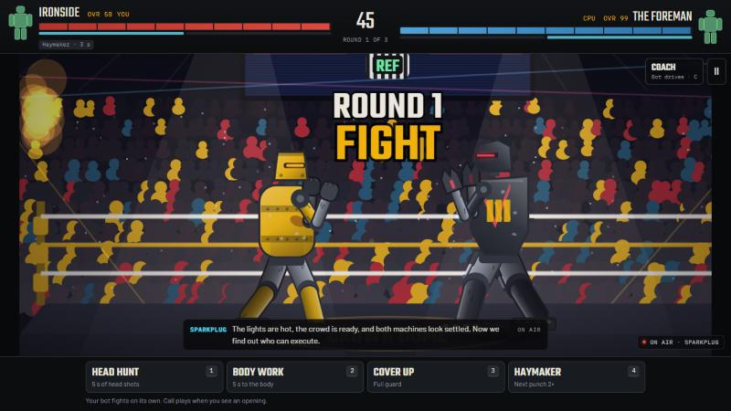
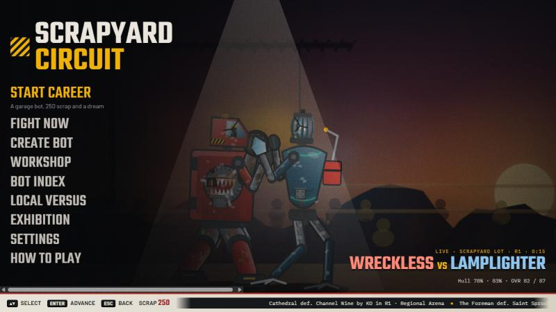
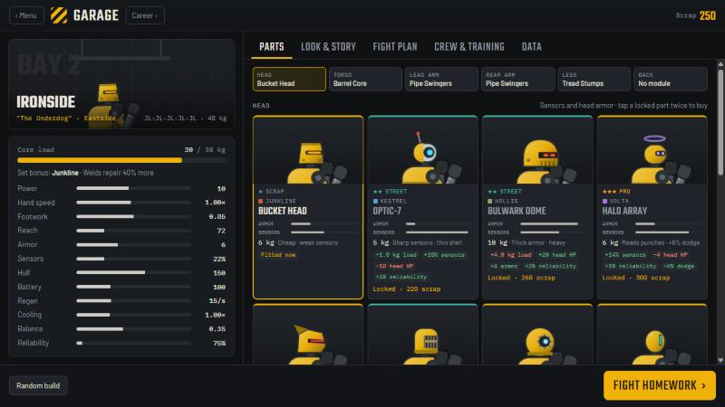
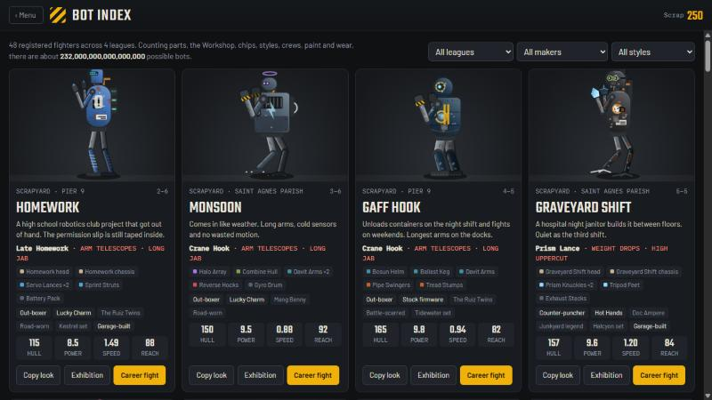

<div align="center">

# SCRAPYARD CIRCUIT

### Robot boxing. Build it, fight it, scrap it.

**Weld a fighter out of junk, coach it from the corner, and climb from the scrapyard to the title.**




</div>

## Your bot fights. You win it from the corner.

Your bot throws its own punches. Your job is to read the fight: watch for the tell, spot the feint, and make the right call before the opening closes. When you'd rather do it yourself, press `C` mid-fight and take the controls.

Every fight leaves marks. Parts crack and tear off, damage turns into oil spills, jammed gears and sensor glitches, and your crew only gets so many welds between rounds. When a fight ends early, the winner makes one last choice: **destroy** the loser for the crowd and the salvage, or **spare** it.

## What's inside

| | |
|---|---|
| 🏆 **Career** | Win purses, buy better parts, crews, chips and signature moves. Beat 3 bots in a league to open the next one. The Foreman waits at the top. |
| 🔧 **Build anything** | Choose parts, paint, story, fight plan and crew, or weld your own head and chassis in the Workshop. There are about 232 quadrillion possible bots. |
| 🥊 **Coach or Pilot** | Time four corner calls, or throw every punch yourself. Switch whenever you like. |
| 👀 **Tells and feints** | A red banner means a signature move is coming. A grey banner is a feint, so don't bite. |
| 💥 **Damage that matters** | Each part is tracked on its own, and what breaks changes how your bot fights. |
| 🎙️ **Fight-night sound** | Recorded commentary, ring names, a referee count and crowds that change by venue. |
| 🎮 **Local versus** | Two players on one keyboard or two controllers. |

## A look around

<table>
  <tr>
    <td width="50%"></td>
    <td width="50%"></td>
  </tr>
  <tr>
    <td align="center"><b>Main menu</b><br>Real fights play out behind the menu</td>
    <td align="center"><b>Garage</b><br>Every part changes your stats</td>
  </tr>
  <tr>
    <td colspan="2"></td>
  </tr>
  <tr>
    <td colspan="2" align="center"><b>Bot Index</b><br>48 registered fighters across 4 leagues, each with its own story and signature move</td>
  </tr>
</table>

## Play it

The game is one static site, with no install, account or build step.

**Run it locally** from a copy of this repository. It needs a web server because it loads its audio list over HTTP:

```bash
python -m http.server 8000
```

Then open <http://localhost:8000>.

**Or put it online** with Vercel: import this repository at [vercel.com/new](https://vercel.com/new), set **Framework Preset** to **Other**, and leave the build settings empty. Each push to `main` redeploys the site.

## Controls

**Keyboard**

| | Coach | Pilot |
|---|---|---|
| **Fight** | `1` Head hunt · `2` Body work · `3` Cover up · `4` Haymaker | `J` jab · `K` cross · `L` hook · `I` uppercut |
| **Move** | Your bot moves on its own | `A` `D` or arrows · `W` `S` change lanes |
| **Defend** | Cover up | `Q` `E` slip · hold `Shift` to guard · `X` clinch |
| **Signature move** | — | `F` |

| In any fight | |
|---|---|
| Switch Coach / Pilot | `C` |
| Reboot after a knockdown (needle in the green) | `Space` or tap |
| Destroy / Spare | `D` / `S` |
| Pause | `Esc` |

<details>
<summary><b>Controller</b></summary>

| Input | Action |
|---|---|
| Stick or d-pad | Move |
| `A` `B` `X` `Y` | Pilot: jab, cross, hook, uppercut. Coach: the four calls |
| `LB` `RB` | Slip |
| `LT` | Guard |
| `RT` | Signature move |
| `Back` | Switch Coach / Pilot |
| `Start` | Pause |

In menus, `A` selects and `B` goes back.

</details>

The in-game **How to play** screen covers the rest.

## Good to know

- **Saves stay in your browser.** Clearing site data removes your progress.
- **Some voice lines vary by device.** Booth commentary is prerecorded with ElevenLabs voices. Lines with no matching recording, such as ones with names or scores, use your browser's built-in voice.
- **It can run like an app.** Served over HTTPS, the game can be installed, and audio it has already played is cached for offline use.

## Project layout

```text
index.html             the whole game: HTML, CSS and JavaScript
manifest.webmanifest   app install details
sw.js                  offline cache
icon-192.png           app icons
icon-512.png
audio/commentary/      commentary, ring names, referee and crowd audio
docs/screenshots/      images used in this README
```

More on the audio is in [`audio/commentary/README.md`](audio/commentary/README.md).
